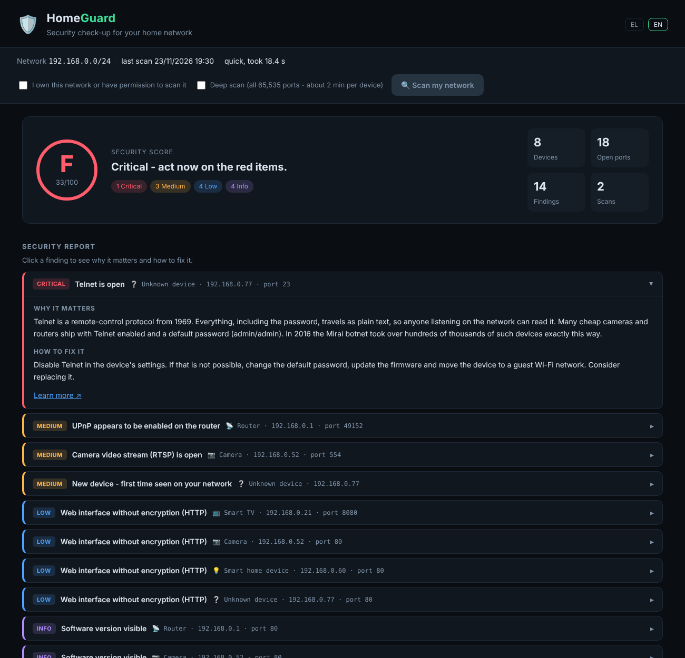

# 🛡️ HomeGuard

**A friendly security check-up for your home network.**
HomeGuard finds every device on your Wi-Fi, checks which "doors" (ports) are open, and explains in plain
words what is risky and how to fix it, in **English** and **Greek**.

> 🇬🇷 [Ελληνικά παρακάτω](#-ελληνικά)


*Screenshot of a fictional demo network (no real devices).*

## Features

- **Finds every device** on your network: ping sweep + ARP table, so it also catches devices that ignore ping
- **Identifies devices**: manufacturer (IEEE OUI database), hostname, and a "detective" that guesses
  what each device is (router, TV, camera, phone, air conditioner, printer...)
- **Port scan + banner grabbing** with automatic TLS detection, plus safe read-only checks
  (for example a Redis server that answers without a password)
- **Security score (A-F)** with clear findings: *why it matters* and *how to fix it*
- **Change detection**: alerts you when a device appears on your network **for the first time**,
  and tells "new device" apart from "a known device came back"
- **History**: when each device was first seen and how often
- **Honest about its limits**: results for the computer running the scan are marked
  "seen from inside" and not counted in the score, because the local firewall is bypassed
- **Print / PDF report** and JSON export
- **Web dashboard** and **terminal version**
- Works on **Windows, Linux and macOS**, with Python only (Flask for the dashboard)

## Quick start

You need [Python 3.10+](https://www.python.org/downloads/).

```bash
git clone https://github.com/<your-username>/homeguard.git
cd homeguard
python -m pip install -r requirements.txt
python app.py
```

Your browser opens at **http://127.0.0.1:5000**. Tick the permission box and press **Scan my network**.

> 🛑 **When you are done**, stop HomeGuard with the **Stop HomeGuard** button at the bottom of the page,
> or press **Ctrl+C** in the terminal window. Don't leave it running in the background.

On Windows you can also just double-click **`run.bat`** (on Linux/macOS run `./run.sh`).

### Terminal version

```bash
python cli.py              # quick scan, English report
python cli.py --lang el    # Greek report
python cli.py --deep       # all 65,535 ports (about 2 minutes per device)
python cli.py --net 192.168.0.0/24
```

## How it works

| Step | What happens |
|---|---|
| 1. Discover | Pings every address in your /24 network in parallel, then reads the ARP table. ARP finds devices that ignore ping, because every device must answer ARP to use the network at all. |
| 2. Identify | The first half of a MAC address (OUI) reveals the manufacturer. The router's DNS often knows the device name (e.g. `iPhone`, `Samsung`). Phones use *random* MACs for privacy, and HomeGuard recognises those too. |
| 3. Ports | A TCP connect scan of ~60 common ports (or all 65,535). Each port is **open**, **closed** (the device said no) or **filtered** (silence: a firewall). |
| 4. Banners | Connects to each open port and asks "who are you?". Many services reply with their software and version, which is exactly what attackers look up in vulnerability databases (CVE). |
| 5. Analysis | Every finding comes from a knowledge base (`homeguard/knowledge.py`) with a severity, an explanation and a fix. The score starts at 100 and loses points per finding. |
| 6. Baseline | Each scan is saved in `scans/`. Comparing with **all** earlier scans tells a brand-new device apart from one that was just away. |

## Security of HomeGuard itself

A security tool should not open new holes, so the dashboard:

- listens **only on 127.0.0.1**, so other devices on your Wi-Fi can't open it
- rejects requests with a foreign `Host` header (protection against *DNS rebinding*)
- requires a secret **CSRF token** to start a scan, so other websites can't trigger scans through your browser
- sends a strict **Content-Security-Policy** with no inline scripts, and Jinja auto-escapes everything,
  because hostnames and banners come from devices and must never be trusted (protection against *XSS*)
- never logs in anywhere, never guesses passwords and never changes anything on your devices
- talks to the internet only once, to download the public manufacturer list

## Limitations

- Scans **TCP** only. UDP services (DNS, SNMP, UPnP discovery...) are not checked.
- Built for home networks (/24 by default, up to /22).
- It sees your network **from the inside**. What is visible from the internet is a different question;
  use an external test such as [GRC ShieldsUP!](https://www.grc.com/shieldsup) for that.
- Some phones change their private MAC address periodically, so a known phone can occasionally look "new".
- Device type detection is a best guess.

## ⚖️ Use responsibly

Scan **only networks you own or have explicit permission to test**. Scanning other people's networks
can be illegal. HomeGuard asks you to confirm this before every scan.

## Project structure

```
app.py                 web dashboard (Flask)
cli.py                 terminal version
homeguard/
  network.py           discovery, ARP, gateway, hostnames, vendors
  ports.py             port scan, banner grabbing, safe probes
  scanner.py           runs a full scan with progress reporting
  analysis.py          device detection, findings, score
  knowledge.py         the security knowledge base (EN + GR)
  storage.py           saved scans, history, change detection
  i18n.py              interface text (EN + GR)
templates/, static/    the dashboard page
```

Contributions are welcome. A good first step is adding a new risk to `knowledge.py`.

## License

MIT, see [LICENSE](LICENSE).

---

## 🇬🇷 Ελληνικά

**Έλεγχος ασφαλείας για το δίκτυο του σπιτιού σου.**
Το HomeGuard βρίσκει κάθε συσκευή στο Wi-Fi σου, ελέγχει ποιες «πόρτες» είναι ανοιχτές και σου εξηγεί
με απλά λόγια τι έχει ρίσκο και πώς να το διορθώσεις.

### Εγκατάσταση

Χρειάζεσαι [Python 3.10+](https://www.python.org/downloads/). Στην εγκατάσταση στα Windows τσέκαρε το «Add python.exe to PATH».

```bash
git clone https://github.com/<your-username>/homeguard.git
cd homeguard
python -m pip install -r requirements.txt
python app.py
```

Ανοίγει ο browser στο **http://127.0.0.1:5000**. Τσέκαρε ότι έχεις άδεια να σκανάρεις το δίκτυο και πάτα
**Σκανάρισμα δικτύου**. Στα Windows μπορείς απλά να κάνεις διπλό κλικ στο **`run.bat`**.

Η γλώσσα αλλάζει από τα κουμπιά **EL / EN** πάνω δεξιά.

> 🛑 **Όταν τελειώσεις**, σταμάτησε το HomeGuard με το κουμπί **Τερματισμός HomeGuard** στο κάτω μέρος της
> σελίδας ή πάτα **Ctrl+C** στο μαύρο παράθυρο. Μην το αφήνεις να τρέχει στο παρασκήνιο.

### Τι κάνει

- Βρίσκει **όλες τις συσκευές** (ping + ARP) και αναγνωρίζει τι είναι η καθεμία
- Ελέγχει τις **ανοιχτές πόρτες** και «ρωτάει» κάθε υπηρεσία ποια είναι (banner grabbing)
- Δίνει **βαθμό ασφαλείας A-F** και για κάθε εύρημα εξηγεί **γιατί έχει σημασία** και **πώς διορθώνεται**
- Σε ειδοποιεί όταν μια συσκευή εμφανιστεί **για πρώτη φορά** στο δίκτυό σου
- Κρατάει **ιστορικό** και βγάζει **αναφορά για εκτύπωση / PDF**

### ⚖️ Υπεύθυνη χρήση

Σκάναρε **μόνο δίκτυα που σου ανήκουν ή έχεις ρητή άδεια** να ελέγξεις. Το σκανάρισμα ξένων δικτύων
μπορεί να είναι παράνομο.
